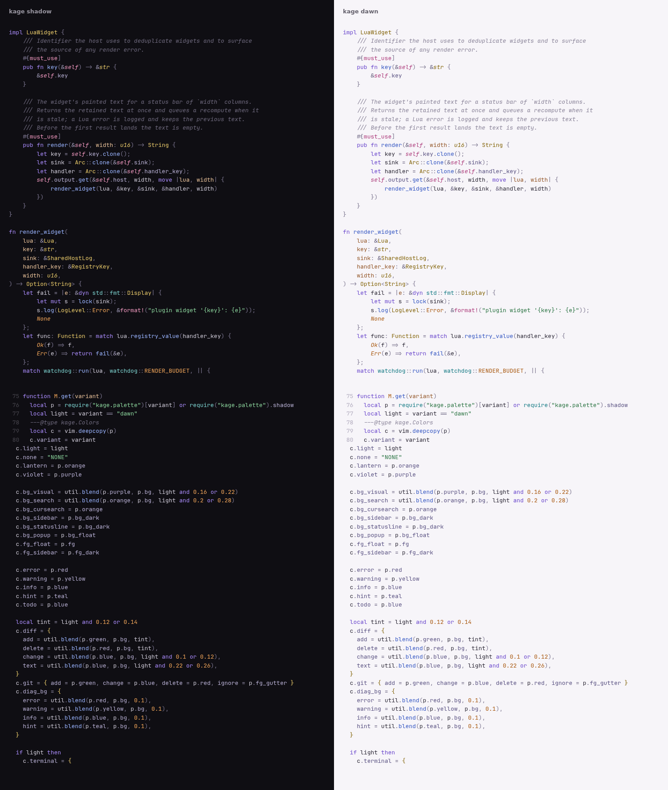

# kage-theme

A dark and a light colorscheme for Neovim, from the palette of
[kage](https://github.com/QaidVoid/kage), with matching configs for terminals
and other apps.

- **kage shadow** (dark): ink surfaces with a violet undertone and one warm
  lantern accent.
- **kage dawn** (light): ink on a violet-tinted paper with the same roles,
  accents deepened so every syntax color keeps at least 4.5:1 contrast.



The full token list, with hex values for both variants, the 16 terminal
colors and what each token is for, is in [PALETTE.md](PALETTE.md).

## Install

Neovim 0.10 or newer.

With the built-in `vim.pack` (Neovim 0.12):

```lua
vim.pack.add({ { src = "https://github.com/QaidVoid/kage-theme" } })
vim.cmd.colorscheme("kage")
```

With [lazy.nvim](https://github.com/folke/lazy.nvim):

```lua
{
  "QaidVoid/kage-theme",
  lazy = false,
  priority = 1000,
  config = function()
    require("kage").setup({})
    vim.cmd.colorscheme("kage")
  end,
}
```

From a local clone:

```lua
vim.opt.rtp:prepend("/path/to/kage-theme")
vim.cmd.colorscheme("kage")
```

## Use

| Command | Result |
|---|---|
| `:colorscheme kage` | follows `'background'`: dark gives shadow, light gives dawn |
| `:colorscheme kage-shadow` | always dark; sets `'background'` to dark |
| `:colorscheme kage-dawn` | always light; sets `'background'` to light |

With `kage`, `:set background=light` switches to dawn and back, so a
system-wide dark and light toggle only has to set `'background'`.

## Options

Call `setup` before `:colorscheme`. Every key is optional; defaults shown:

```lua
require("kage").setup({
  variant = "auto",          -- "auto" (follow 'background'), "shadow" or "dawn"
  transparent = false,       -- leave the terminal background showing
  terminal_colors = true,    -- set vim.g.terminal_color_0 to _15
  styles = {                 -- extra attributes merged into these groups
    comments = { italic = true },
    keywords = {},
    functions = {},
    variables = {},
  },
  on_colors = function(colors) end,           -- change colors before groups are built
  on_highlights = function(hl, colors) end,   -- change groups before they are set
  cache = true,              -- reuse the built groups across sessions
})
```

The cache is rebuilt whenever the options, kage itself or the files defining
the hooks change. If a hook depends on anything else, call
`require("kage").clear_cache()` after changing it (see `:help kage-cache`).

See `:help kage` for examples.

## Colors in your own code

`require("kage").colors()` returns the active variant's color table. Key
names follow tokyonight's (`bg_dark`, `fg`, `fg_dark`, `blue`, `green`,
`magenta`, `red`, `yellow`, `teal`, `purple`, `orange`, ...), so a
statusline written against `require("tokyonight.colors").setup()` works by
swapping that one call. kage adds `lantern` (the accent, same as `orange`),
`violet`, `mist`, `sand`, `fg_strong`, `bg_raised`, and the `diff`, `git`,
`diag_bg` and `terminal` tables. Repaint on `ColorScheme` to follow variant
changes.

A lualine theme is included: `options = { theme = "kage" }`.

## Supported

Editor UI, legacy syntax, treesitter captures, LSP semantic tokens and
diagnostics, plus these plugins: gitsigns, blink.cmp, nvim-cmp, fzf-lua, oil,
octo, telescope, which-key, treesitter-context, indent-blankline,
mini.indentscope, snacks indent, flash, lazy, noice, trouble and
render-markdown.

## Extras

Configs for other apps, generated from the same palette:

| App | Files |
|---|---|
| foot | `extras/foot/kage.ini` (shadow as `[colors-dark]`, dawn as `[colors-light]`), or `kage-shadow.ini` / `kage-dawn.ini` for one variant |
| ghostty | `extras/ghostty/kage-shadow`, `kage-dawn` |
| kitty | `extras/kitty/kage-*.conf` |
| alacritty | `extras/alacritty/kage-*.toml` |
| wezterm | `extras/wezterm/kage-*.toml` |
| fzf | `extras/fzf/kage-*.sh` (`FZF_DEFAULT_OPTS` colors) |
| kage TUI | bundled in kage as `kage-shadow` and `kage-dawn` (`default` follows the terminal); `extras/kage/kage-*.toml` reproduce them as a starting point for a custom theme |
| DankMaterialShell | `extras/dms/kage.json` (custom theme: shadow as dark, dawn as light) |
| CSS | `extras/css/kage.css` (`--kage-*` variables for both variants) |
| JSON | `extras/json/kage.json` (every token, both variants) |

For foot, copy the file next to your config and include it from `foot.ini`.
The files use `[colors-dark]` and `[colors-light]` (tested with foot 1.28,
which rejects a plain `[colors]` section):

```ini
[main]
include=~/.config/foot/kage.ini
```

For DankMaterialShell, select `extras/dms/kage.json` as the custom theme
file in its theme settings. It follows DMS's own light and dark mode. The
equivalent `settings.json` keys are:

```json
"currentThemeName": "custom",
"currentThemeCategory": "custom",
"customThemeFile": "/path/to/kage-theme/extras/dms/kage.json"
```

For wezterm, load a scheme file and select it:

```lua
local scheme = wezterm.color.load_scheme("/path/to/kage-shadow.toml")
config.color_schemes = { ["kage-shadow"] = scheme }
config.color_scheme = "kage-shadow"
```

## Development

`lua/kage/palette.lua` holds the only hand-written colors. Everything else
derives from it.

```sh
nvim --headless --clean -l scripts/gen.lua     # rebuild extras/ and PALETTE.md
nvim --headless --clean -l scripts/check.lua   # load every variant, check links and contrast
stylua --check .                               # formatting
```

CI runs all three and fails when `extras/` or `PALETTE.md` are out of date
with the palette.

## License

MIT. See [LICENSE](LICENSE).
